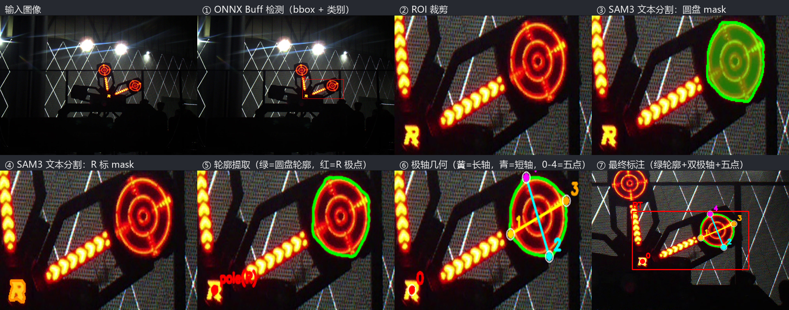

# ArmorLabel

基于 **PySide6 + SAM3** 的 RoboMaster 装甲板 / 能量机关标注系统，支持 YOLO-Pose、半自动 / 全自动标注、视频抽帧与数据集处理工具链。

框架源自 [LuoHuaLabel](https://github.com/luohuabuxiema/LuoHuaLabel)，针对 RM 场景深度定制。

---

## 功能概览

| 能力 | 说明 |
|---|---|
| 多模式标注 | 矩形 / 多边形 / 点 / 旋转框(OBB) / 位姿(Pose) / MLP 数字分类 |
| SAM3 辅助 | 悬停预览、点选确认、文本提示词全图提取 |
| RM 装甲半自动 | 提示词 `number` + `light` → 椭圆拟合灯条 → 收缩 bbox → 4 角关键点 |
| RM 装甲全自动 / 批量 | 当前图一键；目录批量（覆盖 / 跳过 / 追加） |
| Buff 能量机关 | YOLO 粗标 + SAM3 精修 / 扇叶半自动五点 / ONNX+SAM3 一键全自动 |
| 数据集工具 | YOLO 划分、Det/Seg/OBB/Pose 导出、U-Net mask、融合、统计、清洗 |
| YOLO 工具链 | 自动标注（可双层 MobileNet 二次分类）、训练 UI、推理查看 |
| MLP / MobileNet | 装甲数字分类训练与演示 |

---

## 演示

> **说明：** GitHub README 里写 `` 会被当成**图片**渲染，所以只能看到裂图图标。  
> 仓库内相对路径的 `<video>` 也会被过滤。下面用「点进 GitHub 文件页播放」；若要在 README **页内直接播**，见段末说明。

### Buff 位姿全自动标注（Buff 检测网络 + SAM3 文本提示精修，半 zero-shot）

单张一键触发：ONNX Buff 检测框 → SAM3 文本提示精修扇叶 → 自动求解 R 标五关键点 → 自动保存；
点击切换下一张逐张推进（工具内另有目录批量模式）：

[▶ 观看：Buff 全自动标注演示（MP4）](https://github.com/HargereavesQin/bit-auto-label/blob/main/docs/assets/buff_fullauto_demo.mp4)

### Buff 扇叶半自动标注

拖选扇叶 → SAM3 精修轮廓 → 五关键点自动求解，一步复核：

[▶ 观看：Buff 半自动标注演示（MP4）](https://github.com/HargereavesQin/bit-auto-label/blob/main/docs/assets/buff_semiauto_demo.mp4)

### 工作原理：Buff 位姿全自动流水线

单步中间结果可视化（输入 → ONNX 检测 → ROI → SAM3 双文本提示分割 → 轮廓提取 → 极轴几何 → 五关键点）：



五点语义：`0` = R 标极点（SAM3 分割 R 标质心），`1/3` = 圆盘轮廓距极点最近/最远点（长轴两端），`2/4` = 垂直于长轴的最长轮廓弦两端（短轴）。实测与人工标注误差 ≤ 4px。

<details>
<summary>如何在 README 正文里内嵌可播放视频</summary>

1. 打开本仓库任意 **Issue**，在评论框把 `docs/assets/*.mp4` **拖进去**上传。  
2. GitHub 会生成 `https://github.com/user-attachments/assets/...` 链接。  
3. 把演示处改成（`src` 换成你的链接）：

```html
<video src="https://github.com/user-attachments/assets/替换为实际上传ID" controls muted playsinline width="800"></video>
```

只有这种 CDN 地址的 `<video>` 才会在 README 里出现播放器；仓库内相对路径无效。

</details>

---

## 部署与运行环境

> **必须先激活专用环境再启动**（conda `armorlabel` 或项目内 `.venv`）。`run.sh` 默认 conda 环境名：`armorlabel`。

### 当前锁定环境（本仓库实测）

| 组件 | 版本 |
|---|---|
| Conda 环境名 | `armorlabel` |
| Python | **3.13.11** |
| PyTorch | **2.10.0+cu128** |
| torchvision | **0.25.0+cu128** |
| CUDA（torch 自带） | **12.8** |
| cuDNN（随 torch） | 9.10.x（nvidia-cudnn-cu12） |
| PySide6 | 6.11.1 |
| OpenCV | 4.13.0 |
| SAM3 | 0.1.0（`pip install -e ./sam3` 或 site-packages） |
| ultralytics | 8.4.21 |
| onnx / onnxruntime-gpu | 1.20.1 / **1.24.4**（原 1.24.3 在 win+py3.13 无轮子） |

硬件参考：NVIDIA GPU（如 RTX 4090）+ 足够显存加载 `models/sam3.pt`（约 3.4GB）。

也可用 **venv**（不必 conda）：`python -m venv .venv` 后激活，再按下方步骤装依赖。

> 克隆本仓库时建议 `git clone --recurse-submodules`（或克隆后执行 `git submodule update --init`），
> 否则 `sam3/` 目录为空，SAM3 相关功能无法安装。

### 依赖（单一 `requirements.txt`，按段注释分组）

| 分段 | 内容 |
|---|---|
| PyTorch / CUDA | 版本锁定说明；**须用官方 cu128 index 单独安装** |
| 基础 GUI / 通用 | PySide6、OpenCV、NumPy… |
| SAM3 推理 | timm、einops、iopath…（本体另装 sam3） |
| YOLO / ONNX / 分类 | ultralytics、onnxruntime-gpu、scikit-learn… |

### Windows / Linux：SAM3 链路依赖差异

主业务依赖见 `requirements.txt`（跨平台一致）。**SAM3 本体与 Triton 按系统分流**：

| 项目 | Linux（如 Ubuntu 22.04） | Windows |
|---|---|---|
| SAM3 本体 | `git submodule update --init` 后 `pip install -e ./sam3`，或 `git+https://github.com/facebookresearch/sam3.git` | 同左 |
| Triton | 官方 `triton`（常随 CUDA 版 torch 一并出现） | **无官方 triton**；须另装社区包 **`triton-windows`**（本机实测 `3.6.0.post26`，import 名仍为 `triton`） |
| 额外小依赖 | 一般随 sam3 依赖解析 | 若用 `pip install --no-deps` 装 sam3，需自备 **`regex`**（tokenizer 用） |
| NumPy | 上游 sam3 声明 `numpy>=1.26,<2` | 本仓锁定 **`numpy==2.3.5`**；装 sam3 时请加 **`--no-deps`**，避免把 numpy 降到 1.x |
| 权重 | `models/sam3.pt`（约 3.4GB） | 相同 |

Windows 补齐 SAM 运行时示例：

```bash
# 国内源装业务依赖时建议关闭系统/终端代理；拉 GitHub 时再开代理
pip install -r requirements.txt
pip install --no-deps "git+https://github.com/facebookresearch/sam3.git"
# 或: pip install --no-deps -e ./sam3
pip install triton-windows==3.6.0.post26 regex
```

校验 SAM（建议在临时目录执行，避免仓库内 vendored `ultralytics/` 抢占同名包）：

```bash
python -c "import torch; from sam3.model_builder import build_sam3_image_model; print(torch.__version__, torch.cuda.is_available())"
```

### 推荐安装步骤

```bash
# 1) 创建并激活环境（名称可与 run.sh 中 CONDA_ENV 一致）
conda create -n armorlabel python=3.13 -y
conda activate armorlabel
cd /path/to/armor-label

# 2) CUDA 版 PyTorch（务必用 cu128 官方源，勿用默认 PyPI 装错轮子）
pip install torch==2.10.0 torchvision==0.25.0 \
  --index-url https://download.pytorch.org/whl/cu128

# 3) 其余依赖 + SAM3 本体
pip install -r requirements.txt
pip install --no-deps -e ./sam3
# 备选: pip install --no-deps "git+https://github.com/facebookresearch/sam3.git"
# Windows 额外: pip install triton-windows==3.6.0.post26 regex
```

校验：

```bash
conda activate armorlabel   # 或: .venv\Scripts\activate
python -c "import torch; print(torch.__version__, torch.cuda.is_available(), torch.version.cuda)"
python -c "from sam3.model_builder import build_sam3_image_model; import PySide6, cv2; print('ok')"
```

### 模型权重

| 文件 | 用途 |
|---|---|
| `models/sam3.pt` | SAM3 辅助 / 半自动 / 全自动（必需，约 3.4GB） |
| `models/best.pt` / `models/best.onnx` | YOLO-Pose 自动标注 / Buff 相关 |
| `stored_weights/...` | MLP / MobileNet 等分类权重（可选） |

SAM3 权重： [Hugging Face facebook/sam3](https://huggingface.co/facebook/sam3/tree/main)

### 启动

```bash
# 推荐：自动激活 conda 并启动
chmod +x run.sh   # 首次
./run.sh

# 或手动
conda activate armorlabel
python main.py
```

环境名覆盖：`CONDA_ENV=你的环境名 ./run.sh`，或编辑 `scripts/env.local`（参考 `scripts/env.local.example`）。

### 独立工具启动

```bash
conda activate armorlabel
python tools/main_dataset_tool.py       # 数据集处理
python tools/video_frame_extractor.py   # 视频抽帧
python tools/yolo_auto_annotate.py      # YOLO 批量自动标注（可双层 MobileNet）
python tools/yolo_train.py              # YOLO 训练 UI
python tools/yolo_inference.py          # YOLO 推理查看
python tools/mlp_train.py               # MLP / MobileNet 训练
python tools/mlp_demo.py                # MLP 演示
python tools/armor_data_extractor.py    # 装甲数据提取
```

菜单入口：主窗口 **工具** / **设置**。

---

## 快捷键与模式切换（完整）

应用内按 **F1** 也可打开帮助。下列与 `main.py` / `core/canvas.py` 行为一致。

### 1. 标注模式切换

| 快捷键 | 模式 | SAM 可用 | 说明 |
|---|---|---|---|
| **R** | 矩形 (HBB) | ✅ | 水平包围盒 |
| **P** | 多边形 | ✅ | 顶点多边形；可吸附边缘 |
| **T** | 点 | ❌（强制关） | 单点标注 |
| **O** | 旋转框 (OBB) | ✅ | 带角度包围盒，角点贴图边界滑动 |
| **U** | 位姿 (Pose) | ✅ | bbox + 关键点；右侧出现位姿面板 |
| **M** | MLP 分类 | ❌（强制关） | 数字分类标注；**Enter** 确认当前标签 |

左侧工具栏模式按钮与上表快捷键等价。

### 2. SAM 智能辅助

| 快捷键 / 操作 | 作用 |
|---|---|
| **Q** | 开启 / 关闭 SAM 开关（与右侧拨片同步） |
| 悬停 | SAM 开启时预览分割轮廓 |
| 左键点击 | 确认当前预览，按当前模式生成矩形或多边形等 |
| 右下角提示词 + **Enter** | 文本提示全图提取（如 `car`、`number`）；输出形状跟随当前模式 |

注意：

- 启动后 SAM 在后台线程加载；`sam_loading` 期间 **禁止 A/D 切图**，否则易崩溃。
- 点模式 / MLP 模式下 SAM 自动不可用。
- 权重路径：`models/sam3.pt`；设备见 **设置 → SAM_DEVICE**（改后需重启）。

### 3. 图片导航与文件

| 快捷键 | 作用 |
|---|---|
| **A** / **←** | 上一张 |
| **D** / **→** | 下一张 |
| **Ctrl + S** | 保存当前标注 |
| **Ctrl + Z** | 撤销 |
| **Ctrl + Y** | 重做 |
| **F1** | 打开本帮助说明 |

长按 A/D 会节流连切（约 180ms）；SAM/LoRA 加载特征时导航被拦截并提示等待。

### 4. 类别 / 实例切换（W / S）

| 快捷键 | 行为 |
|---|---|
| **W** | 上一个类别；位姿模式且选中 Pose 实例时，切换该实例类别向上；层级模式则切层级面板 |
| **S**（无 Ctrl） | 下一个类别；位姿 / 层级逻辑同 W 向下 |
| **Ctrl + S** | 保存（不切换类别） |

普通模式下 W/S 操作左侧类别列表当前行。

### 5. 通用编辑

| 快捷键 / 操作 | 作用 |
|---|---|
| **Esc** | 取消当前绘制 |
| **Del** / **Backspace** | 删除选中标注 |
| **右键** | 删除标注（或对关键点切换可见性，见位姿） |
| 长按右键拖动 | 连续擦除一批标注 |
| 滚轮 | 缩放 |
| 中键拖动 | 平移画布 |
| 左键拖动 | 按当前模式绘制 / 移动选中框 |

### 6. 多边形专用

| 操作 | 作用 |
|---|---|
| 左键 | 添加顶点 |
| **Ctrl + Z**（绘制中） | 撤销上一个顶点 |
| **双击** / **Enter** | 闭合多边形（至少 3 点） |
| **Esc** | 取消绘制 |

### 7. 旋转框 (OBB) 专用

选中旋转框后：

| 快捷键 | 作用 |
|---|---|
| **Z** | 逆时针旋转 5° |
| **V** | 顺时针旋转 5° |
| **X** | 逆时针旋转 1° |
| **C** | 顺时针旋转 1° |

四个角点会被钳制在图像边界内（贴墙滑动，属预期行为）。

### 8. 位姿模式 (U)

进入后右侧 **位姿面板** 管理类别与实例。

#### 8.1 四种组合方式（面板开关，无额外快捷键）

| 方式 | SAM（Q） | 半自动（面板按钮） | 流程 |
|---|---|---|---|
| 手动 | 关 | 关 | 拖拽 bbox → 在框内点击放置关键点 |
| SAM 辅助 | 开 | 关 | 悬停预览 → 点击确认 bbox；也可拖拽新建 |
| RM 半自动 | 关 | 开 | 拖拽 bbox → 检测数字+灯条 → 收缩 → 放置 4 角点 |
| SAM + 半自动 | 开 | 开 | 点击区域 → SAM 出框 → 半自动收缩 → 关键点 |

说明：面板提示「位姿实例已就绪，可直接拖拽 bbox」；**Space** 在位姿模式下主要给出状态提示（不强制先按 Space 才能标）。

#### 8.2 关键点

| 操作 | 作用 |
|---|---|
| bbox 内左键 | 按骨架顺序添加关键点 |
| **右键关键点** | 可见性循环：`0 未标注 → 1 遮挡 → 2 可见 → 0`（灰 / 橙 / 绿） |
| **W / S** | 切换位姿类别，或对选中 Pose 实例改类 |

#### 8.3 位姿面板功能（按钮，非快捷键）

**模式切换**

- **装甲板**：RM 椭圆拟合半自动 / 全自动
- **能量机关 Buff-Merge**：YOLO + SAM 流程

**RM 装甲板**

- **半自动: 开/关**：见上表
- **全自动**：当前图一键
- **批量**：目录级全自动（策略：overwrite / skip / append）
- **等效覆盖**：把当前图 pose 几何复制到后续图（固定机位连续帧；会跳过 SAM 加载以免阻塞）

**Buff**

- 选择 YOLO pose 权重 → **YOLO 粗标**
- 输入提示词 → SAM 精修选中实例
- **扇叶半自动**：拉框 → SAM3 双轮廓 → 极轴五点
- **BUFF SAM3 一键全自动**：ONNX ROI + SAM3 解五点

位姿类别配置：`config/pose_classes.json`，可用设置中的位姿配置对话框编辑。

### 9. MLP 分类模式 (M)

| 操作 | 作用 |
|---|---|
| **M** | 进入 MLP 分类标注 |
| **Enter** | 确认当前 MLP 标签 |
| SAM | 不可用 |

配合 **工具 → MLP 训练 / MobileNet 训练 / MLP 演示** 使用。

---

## 鼠标与界面约定（补充）

- **左上角工具栏**：打开目录、模式按钮、SAM 拨片
- **左侧**：类别列表（右键删类）、实例列表
- **右侧（Pose）**：类别 / 实例 / 半自动与全自动控件
- **状态栏**：坐标、模式名、SAM/加载提示
- 空标注保存会写出**空文件**（表示已审、无目标），属预期

---

## 参数设置

**设置 → 参数设置**，持久化到 `~/.config/ArmorLabel/settings.ini`（部分旧项仍可能在 `~/.config/LuoHuaLabel/`）。

### RM 半自动

| 参数 | 默认 | Key |
|---|---|---|
| 灯条垂直角度阈值 | 50.0° | `RM_VERTICAL_ANGLE_THRESHOLD` |
| 灯条平行角度阈值 | 45.0° | `RM_PARALLEL_THRESHOLD` |
| 灯条长度最小比例 | 0.5 | `RM_BAR_LENGTH_MIN_RATIO` |
| 搜索半径比例 | 1.5 | `RM_SEARCH_RADIUS_RATIO` |
| ROI 边距 | 10px | `RM_ROI_PADDING` |
| 覆盖层显示时长 | 1000ms | `RM_OVERLAY_TIMEOUT` |

### 通用

| 参数 | 默认 | Key |
|---|---|---|
| 撤销栈深度 | 20 | `MAX_HISTORY_STEPS` |
| 边缘吸附 | 8px | `SNAP_THRESHOLD` |
| SAM 设备 | cuda | `SAM_DEVICE`（改后**重启**） |

### YOLO

| 参数 | 默认 | Key |
|---|---|---|
| 置信度 | 0.25 | `YOLO_CONF` |
| IOU | 0.7 | `YOLO_IOU` |
| 输入边长 | 640 | `YOLO_IMGSZ` |
| 设备 | cuda | `YOLO_DEVICE`（可热更新） |

设备取值：`cuda` / `cpu` / `0` / `1` / …

独立工具窗口配置另存于 `~/.config/LuoHuaLabel/tool_configs.yaml`。

---

## 数据集处理工具

**工具 → 数据集处理**（或 `python tools/main_dataset_tool.py`）：

| 模式 | 输入 | 输出 |
|---|---|---|
| YOLO_SPLIT | 已有 YOLO 图+标 | train/val/test + `data.yaml`（默认 0.7/0.2/0.1） |
| TO_YOLO_DET | JSON/XML | YOLO 检测（仅矩形；不含 pose） |
| TO_YOLO_SEG | JSON | YOLO 分割 |
| TO_YOLO_OBB | JSON | YOLO OBB |
| TO_YOLO_POSE | JSON | YOLO Pose（勿混 polygon/rectangle） |
| UNET | JSON | 像素 mask |

另有：数据集融合、批量重命名、统计、清理无标签图等（见 **工具** 菜单）。

---

## 视频抽帧

**工具 → 视频抽帧**：双帧预览、时间范围双滑块、间隔精度 0.001s、可取消后台任务。

输出命名：`{前缀}_{帧序号:06d}.{格式}`，例如 `video_000123.jpg`。

---

## 导出格式

### JSON（LabelMe 风格）

- 矩形 / 多边形 / 点 / OBB（`rect` + `angle`）
- Pose：`keypoints` + `kpt_names`，`shape_type: pose`

### YOLO

- Det：`cls cx cy w h`
- Seg：`cls x1 y1 …`
- OBB：`cls` + 4 角点归一化
- Pose：`cls cx cy w h` + `kx ky v …`

### Pascal VOC XML

含可选 `<keypoints>`。

---

## 架构速查

| 路径 | 角色 |
|---|---|
| `main.py` | 主窗口、快捷键、撤销、批量状态机 |
| `core/canvas.py` | 画布、模式枚举、SAM 预览、OBB 键位 |
| `core/shapes.py` / `pose_shapes.py` | 各类图形 |
| `core/sam_client.py` | SAM3 三线程加载 / 推理 |
| `core/rm_armor_auto.py` | 装甲半自动 |
| `core/rm_buff_merge_auto.py` | Buff 合并全自动 |
| `core/exporter.py` | JSON / YOLO / XML |
| `core/yolo_client.py` | YOLO 推理与双层分类 |
| `core/mlp_classifier.py` | 数字分类 |
| `tools/` | 独立工具窗口 |
| `ui/` | 界面与 QSS |
| `sam3/` | 离线 SAM3 源码（只读维护，改动应回上游） |
| `core/lora_sam_client.py` / `lora/` | SAM3 LoRA 微调推理与训练（可选扩展，非主要功能） |
| `config/pose_classes.json` | 位姿骨架定义 |

---

## 注意事项

1. **切图与 SAM**：特征加载中禁止 A/D；否则可能崩溃。
2. **空文件保存**：清空标注再保存会写空标注文件，用于标记「已看过」。
3. **OBB 贴墙**：角点不能拖出图像外，属碰撞处理。
4. **大图性能**：4K+ 叠加大量多边形时缩放/平移会变慢，属 QGraphicsScene 成本。
5. **SAM 设备变更需重启**；YOLO 设备即时生效。
6. **勿提交** `models/*.pt`、`datasets/`、`runs/`、大图视频等 gitignore 产物。
7. 无人机远距小装甲场景，SAM 文本提示效果可能明显弱于第一视角。

---

## 参考文献

- 原始框架：[LuoHuaLabel](https://github.com/luohuabuxiema/LuoHuaLabel/)
- SAM3：[Segment Anything with Concepts](https://arxiv.org/abs/2511.16719) · [GitHub](https://github.com/facebookresearch/sam3)
- PyTorch CUDA 轮子：[https://pytorch.org/get-started/locally/](https://pytorch.org/get-started/locally/)
